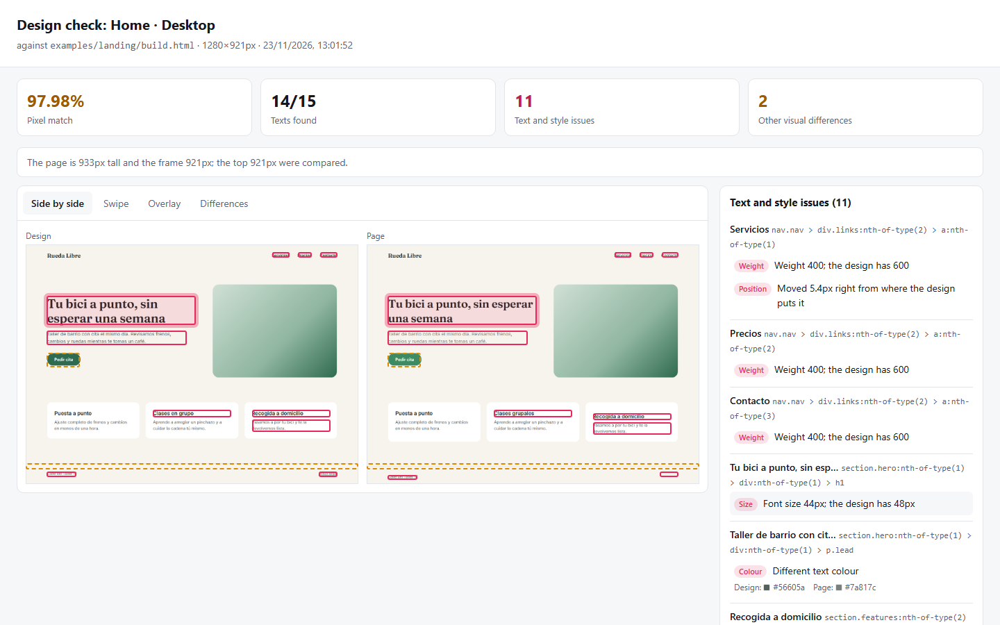

# Frameproof

Checks a built page against its Figma design and writes one HTML report a designer and a developer can both read.

**Figma file:** [the report's screens as editable Figma layers](https://www.figma.com/design/W7sici9lPeKEN3xxYpcUQP/Frameproof-Diseno-del-informe) (view-only).

It opens the page in a real browser at the frame's width, then compares it with the design in two ways:

- **Texts and type:** for every text layer in the Figma frame it finds the matching element on the page and checks the content, font, size, weight, line height, letter spacing, colour and position. Each problem names the layer, the CSS selector and the two values ("Font size 44px; the design has 48px").
- **Pixels:** a pixel diff of the whole frame. Changes that the text checks already explain are taken out, so what's left are the other differences (a button background, an image, a border, a gap), each with its size, position and, when it's a flat colour, the design and page colours.

> **Español:** compara una web con su diseño de Figma (textos, tipografías, tamaños, colores, posiciones y píxeles) y genera un informe HTML con cada diferencia señalada sobre las dos imágenes. Informe en inglés o español (`--lang es`).

**Demo report:** https://nuvia-ortiz.github.io/frameproof/ (generated by CI from [`examples/landing`](examples/landing): a design and a build with seven planted slips).



## Use it

```bash
git clone https://github.com/nuvia-ortiz/frameproof && cd frameproof
npm install            # also builds
npx playwright install chromium

# With a Figma link (Figma → Settings → Security → Personal access tokens, read-only file content is enough)
export FIGMA_TOKEN=figd_…
node dist/cli.js https://staging.example.com "https://www.figma.com/design/KEY/Site?node-id=12-34"

# Without a token: a 1x PNG of the frame, plus the saved nodes JSON if you want the text checks
node dist/cli.js http://localhost:3000 -d home.png --figma-json home.json
```

The page can be a URL, a host (`localhost:3000`) or a local HTML file. The link must point at a **frame** (right-click the frame → Copy link to selection). The report goes to `frameproof-report/`: `index.html`, `report.json`, and the design, page and diff PNGs.

| Option | |
| --- | --- |
| `--design`, `-d` | Figma frame link or PNG exported at 1x (can also be the second argument) |
| `--figma-json` | saved `GET /v1/files/:key/nodes` response, for text checks with a PNG |
| `--out`, `-o` | report folder |
| `--lang` | `en` or `es` |
| `--height` | browser window height; set it to the design's screen height when the page uses `vh` (default: frame height, up to 1200) |
| `--wait-for` | selector to wait for before capturing |
| `--hide` | selector to hide, e.g. a cookie banner or chat widget (repeatable) |
| `--delay` | extra ms after load |
| `--header` | request header such as `"Authorization: Basic …"` for a protected staging site (repeatable) |
| `--threshold` | pixel colour sensitivity 0–1 (default 0.05) |
| `--position` | px a text may drift before it counts as moved (default 4) |
| `--fail-on` | `text`, `any` or `never`: exit code 1 when issues are found, for CI |

### In CI

```yaml
- run: npx playwright install --with-deps chromium
- run: node frameproof/dist/cli.js "$PREVIEW_URL" "$FIGMA_FRAME" --fail-on text
  env:
    FIGMA_TOKEN: ${{ secrets.FIGMA_TOKEN }}
- uses: actions/upload-artifact@v4
  if: always()
  with: { name: design-check, path: frameproof-report }
```

## How it decides

- **Matching texts.** Layers whose text appears exactly on the page are paired first, then near matches (typos, punctuation). If two layers say the same thing ("Add", "Add") the closest element wins. Copy that was rewritten is still found when an element sits where the layer is, and is reported as changed text instead of missing.
- **Position** is compared on the side the text is aligned to (left, centre or right), so a centred title in a wider box isn't flagged. Boxes are the elements' content boxes, which is what a Figma text layer measures.
- **Defaults** tolerate what isn't worth a ticket: 4px of drift, 0.5px of font size, 1px of line height, a colour distance of 12 (out of 441), anti-aliasing in the pixel diff, and specks under 256px².
- **Animations** and transitions are switched off and fonts are awaited before the capture.

## Limits

- One frame per run, at its width. Run it once per breakpoint frame (desktop, tablet, mobile).
- Text styles only. Fills, strokes, radii and shadows of shapes are covered by the pixel diff, not checked property by property.
- Images that differ on purpose (real photos instead of placeholders) show up as visual differences. Hide them with `--hide` if they are noise.
- Mixed styles inside one Figma text layer (one bold word) are compared against the layer's base style.
- The Figma API path is covered by tests with a mocked API; the end-to-end tests use a saved nodes file, so they run without a token.

## Develop

```bash
npm test          # unit: Figma parsing, text matching, tolerances, region grouping, API calls (Vitest)
npm run e2e       # CLI + real browser: the design against itself is 100% clean, every planted slip is found, the report works
npm run demo      # writes examples/landing/report/
npm run fixture   # re-renders examples/landing/design.html into design.png + design.figma.json
```

The example design is an HTML page rendered into the same two files a Figma export gives, so the tests don't depend on a Figma account. The e2e test renders it again on the machine that runs it, so fonts and anti-aliasing always match.

TypeScript, Playwright, pixelmatch, pngjs. Node 20+.

## License

MIT. The example uses Inter and Fraunces under the SIL Open Font License (see `examples/landing/fonts`).
